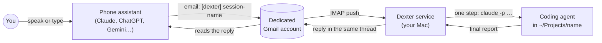

# Dexter

Drive coding agents on your Mac from your phone, over email.

You ask the AI assistant on your phone to start a project or to tell a running project what to do next. The assistant sends an email to a Gmail account that only Dexter uses. Dexter is a small .NET service on your Mac. It reads the email, runs a coding agent (Claude Code today) in the right project folder, and replies in the same email thread. Your phone assistant reads the reply to you.

Use it to check on hours of agent work while you are away from your desk, and to answer an agent's questions so it doesn't sit blocked until you get back.

## How it works



- **One email thread is one session.** The subject is `[dexter] <session-name>`. Dexter maps the Gmail thread to the agent's session, so every reply in the thread continues the same conversation with the agent.
- **Each message is one bounded run.** Dexter starts the agent, waits for it to exit (30 minutes at most), and emails back the agent's final message. Nothing stays running between messages.
- **`[dexter] sessions`** is a thread Dexter updates after every change. It lists each session, its folder, and whether it is working, idle, waiting on you, or stopped with an error. The phone assistant reads it to answer "what am I running?" without waking an agent.
- **No open ports.** The Mac only makes outbound connections to Gmail.
- **No LLM inside Dexter.** It is plumbing. The intelligence is in the phone assistant and the coding agent.

### Guardrails

- Dexter only accepts mail that the Dexter account sent itself (Gmail's `Sent` label). Mail from anyone else is ignored.
- Agents only work in folders directly inside `DEXTER_WORKSPACE` (default `~/Projects`), and never in Dexter's own folder.
- Nobody is at the keyboard to approve permission prompts, so Claude Code runs in auto mode and refuses anything that would need approval. The reply lists what was refused, and you can answer from your phone.
- Only sessions Dexter created are visible from the phone. Your other agent sessions on the Mac are never listed.

## Use a new Gmail account for Dexter

**Create a completely new Gmail account for Dexter. Don't use your existing email address.**

Your phone assistant gets access to Dexter through its Gmail connector, and a Gmail connector can read the whole mailbox it is connected to. If you connect your personal account, the assistant can read all of your personal email. With a dedicated account, the only mail it can see is the Dexter mail. The account is the sandbox.

## Setup

### What you need

- A Mac with the [.NET 8 SDK](https://dotnet.microsoft.com/download) or later.
- [Claude Code](https://code.claude.com/docs) installed and logged in (`claude` on your `PATH`).
- A new Gmail account for Dexter, with 2-Step Verification turned on.
- A phone assistant that can send and read email in that Gmail account.

### 1. Install Dexter on the Mac

1. In the new Gmail account, create an app password at [myaccount.google.com/apppasswords](https://myaccount.google.com/apppasswords).
2. Clone this repository and create your settings file:

   ```bash
   git clone https://github.com/rachiet/dexter.git
   cd dexter
   cp .env.example .env
   ```

3. Fill in `.env`:

   ```bash
   GMAIL_ADDRESS=your-dexter-account@gmail.com
   GMAIL_APP_PASSWORD=the app password
   DEXTER_WORKSPACE=~/Projects   # agents may only work in folders directly inside this one
   ```

4. Install and start the service:

   ```bash
   ./dexter install
   ```

   Dexter now runs in the background and starts again when you log in. Each time it starts, it sends a `[dexter] sessions` email to the account.

The control script also has `start`, `stop`, `restart` (rebuilds first), `status`, `logs`, `uninstall`, and `run` (runs in the foreground, for testing). The log file is `data/logs/dexter.log`.

### 2. Set up the phone assistant

The file [`phone-skill/dexter/SKILL.md`](phone-skill/dexter/SKILL.md) teaches an assistant how to talk to Dexter: how to start a session, send a message to one, and read the status list. It holds no personal values. The assistant finds Dexter's address by itself.

**Claude**

1. In Claude's settings, connect the Gmail connector, and sign in with the **Dexter** account, not your personal one.
2. Turn on Code execution, which skills need, and upload `phone-skill/dexter-skill.zip` as a skill.
3. Try it: "Start a new project called hello-world that prints today's date."

> **Note:** Claude's voice mode does not load skills. Use the microphone (dictation) in a normal chat instead. Your speech becomes a typed message, and the skill works. This is a limitation of Claude's voice mode at the time of writing, not of Dexter. If a future version of voice mode loads skills, you won't need this workaround.

**ChatGPT, Gemini or another assistant**

Dexter only needs an assistant that can send and read email in the Dexter Gmail account. The protocol is plain email, so nothing in Dexter is tied to Claude.

1. Connect the assistant to the Dexter Gmail account with whatever email integration it offers.
2. Give it the contents of `SKILL.md` as its instructions, for example as custom instructions or a saved assistant.

Check your assistant's own documentation to see whether it can send email, not only read it.

## Using it

Talk to your phone assistant normally. It turns what you say into the email format below.

| You say | The assistant does |
|---|---|
| "What am I running?" | Reads the latest `[dexter] sessions` email |
| "Start a project called recipes: a recipe app in Next.js" | Sends a new `[dexter] recipes` email |
| "Tell recipes to use Tailwind" | Replies in the `[dexter] recipes` thread |
| "Did recipes reply?" | Reads the newest message in that thread |

### The email format

A new session is a new email:

```
Subject: [dexter] recipes

action: new
folder: recipes
agent: claude
---
Build a recipe app in Next.js ...
```

A message to a running session is a reply in its thread:

```
action: message
---
Use Tailwind for styling.
```

`folder` is a plain folder name inside `DEXTER_WORKSPACE`, and Dexter creates it if it doesn't exist. `agent` is optional and defaults to `DEXTER_DEFAULT_AGENT`.

Each agent reply ends with two lines that Dexter reads to set the session's status:

```
STATUS: <where things stand>
QUESTIONS: <questions for you, or "none">
```

The rules the agent follows are in [`agent-rules.md`](agent-rules.md). Dexter appends them to the agent's system prompt on every run.

## Using a different coding agent

Dexter ships with one agent adapter, Claude Code. To add another agent, such as Codex:

1. Implement `IAgentAdapter` in [`src/Dexter/Agents.cs`](src/Dexter/Agents.cs). An adapter runs one headless step of the agent in a folder, resumes the agent's session by id, and returns the agent's final message. `ClaudeAgent` in the same file is the example to follow.
2. Register it in [`src/Dexter/Program.cs`](src/Dexter/Program.cs) next to `ClaudeAgent`.
3. Pick it per session with `agent: <name>` in the email, or for every session with `DEXTER_DEFAULT_AGENT` in `.env`.

## Settings

| Setting | Default | Meaning |
|---|---|---|
| `GMAIL_ADDRESS` | (required) | Dexter's Gmail account |
| `GMAIL_APP_PASSWORD` | (required) | App password for that account |
| `DEXTER_WORKSPACE` | `~/Projects` | Where agents may work |
| `DEXTER_DEFAULT_AGENT` | `claude` | Agent used when an email doesn't name one |
| `DEXTER_CLAUDE_PATH` | `claude` | Path to the Claude Code CLI |
| `DEXTER_RUN_TIMEOUT_MINUTES` | `30` | Time limit for one agent run |
| `DEXTER_DATA_DIR` | `./data` | SQLite database and logs |
